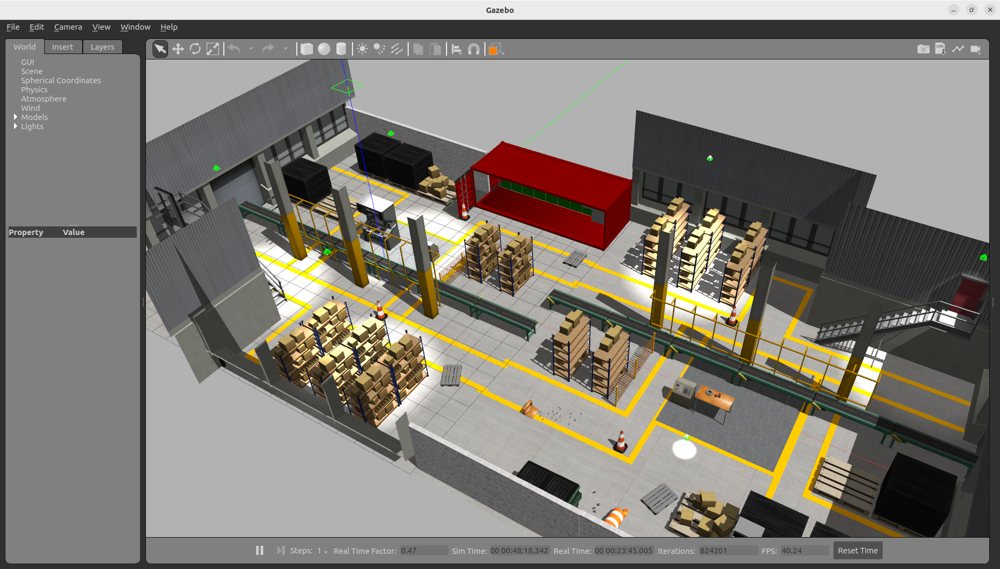
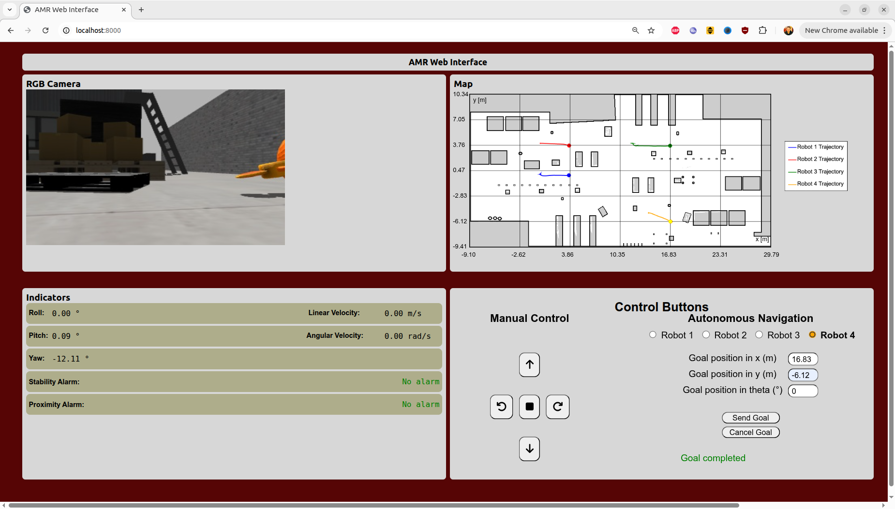

# Class 3: Web Interfaces for Mobile Robot Monitoring & Teleoperation in ROS 2 🌐🤖

This comprehensive guide unifies **system execution** and **in-depth architectural explanation** for building a modern, real-time web monitoring and teleoperation dashboard for autonomous mobile robots (AMRs / TurtleBot 3) using **ROS 2 Humble**, **`rosbridge_suite`**, **`web_video_server`**, and **`roslibjs`**.

---

## 📋 Prerequisites
Before starting, ensure that your system satisfies:
* **Operating System:** [Ubuntu 22.04 LTS (Jammy Jellyfish)](https://releases.ubuntu.com/22.04/)
* **Middleware:** [ROS 2 Humble Hawksbill](https://docs.ros.org/en/humble/Installation.html)
* **Simulator:** Gazebo Classic 11 (`sudo apt install ros-humble-gazebo-*`)
* **Navigation Stack:** Nav2 (`sudo apt install ros-humble-navigation2 ros-humble-nav2-bringup`)
* **Robot Models:** TurtleBot 3 packages (`sudo apt install ros-humble-turtlebot3*`)
* **Web Bridge Packages:**
  ```bash
  sudo apt install ros-humble-rosbridge-server ros-humble-web-video-server
  ```
* **Build System:** `colcon` build tools (`sudo apt install python3-colcon-common-extensions`)
* **Web Browser:** Any modern browser (Google Chrome, Firefox, Microsoft Edge)

---

## Table of Contents
- [Prerequisites](#-prerequisites)
- [1. Motivation & Full-Stack Robotics Web Architecture](#1-motivation--full-stack-robotics-web-architecture)
  - [1.1 Why Web Interfaces for Robotics?](#11-why-web-interfaces-for-robotics)
  - [1.2 The Communication Bridge Problem](#12-the-communication-bridge-problem)
  - [1.3 System Architecture Diagram](#13-system-architecture-diagram)
- [2. Cloning the Project Repository](#2-cloning-the-project-repository)
- [3. Safe Workspace Compilation & Sourcing](#3-safe-workspace-compilation--sourcing)
- [4. Step-by-Step System Execution](#4-step-by-step-system-execution)
  - [4.1 Network IP Configuration](#41-network-ip-configuration)
  - [4.2 Terminal 1: Launch Gazebo, Nav2, and Bridge Servers](#42-terminal-1-launch-gazebo-nav2-and-bridge-servers)
  - [4.3 Terminal 2: Serve the Web Client](#43-terminal-2-serve-the-web-client)
  - [4.4 Visual System Verification](#44-visual-system-verification)
- [5. Pedagogical Architecture & Code Deep Dive](#5-pedagogical-architecture--code-deep-dive)
  - [5.1 Semantic Web Structure (`index.html`)](#51-semantic-web-structure-indexhtml)
  - [5.2 Visual Design System (`style.css`)](#52-visual-design-system-stylecss)
  - [5.3 WebSocket Communication Core (`index3.js`)](#53-websocket-communication-core-index3js)
  - [5.4 Manual Teleoperation & Dynamic Robot Switching](#54-manual-teleoperation--dynamic-robot-switching)
  - [5.5 Telemetry Mathematics & Safety Alarms](#55-telemetry-mathematics--safety-alarms)
  - [5.6 Real-Time Camera Streaming with `web_video_server`](#56-real-time-camera-streaming-with-web_video_server)
  - [5.7 2D Occupancy Grid Map & Trajectory Visualization (Canvas)](#57-2d-occupancy-grid-map--trajectory-visualization-canvas)
  - [5.8 Autonomous Navigation Bridge with Nav2](#58-autonomous-navigation-bridge-with-nav2)
- [6. Testing & Operational Verification Checklist](#6-testing--operational-verification-checklist)
- [7. Troubleshooting & Common Pitfalls](#7-troubleshooting--common-pitfalls)
- [8. Summary: ROS CLI vs Web Interfaces](#8-summary-ros-cli-vs-web-interfaces)
- [9. Deliverables and Grading Rubric](#9-deliverables-and-grading-rubric)
- [🤝 Contributing and Contact](#-contributing-and-contact)

---

## 1. Motivation & Full-Stack Robotics Web Architecture

### 1.1 Why Web Interfaces for Robotics?
In industrial robotics, laboratory environments, and automated warehouses, operators cannot always connect via SSH or open heavy desktop GUI visualizers like RViz or `rqt`. Web interfaces offer distinct advantages:
* **Zero Client Installation:** Any device with a modern web browser (laptop, tablet, smartphone) becomes a control station.
* **Cross-Platform Compatibility:** Runs seamlessly on Linux, macOS, Windows, Android, and iOS.
* **Decoupled Architecture:** Teleoperation and monitoring run independently from the robot's real-time controllers.
* **Scalable Fleet Management:** Centralized dashboards can monitor and switch between multiple mobile robots simultaneously.

### 1.2 The Communication Bridge Problem
Standard ROS 2 uses **DDS (Data Distribution Service)** running over UDP/IP for inter-node communication. Web browsers, by contrast, operate inside a sandboxed JavaScript security environment and cannot open raw UDP or TCP sockets. 

To bridge this gap, two protocol translation bridges are used:
1. **`rosbridge_server` (Port 9090):** Opens a WebSocket server (`ws://<IP>:9090`). It accepts JSON messages sent by JavaScript clients via **`roslibjs`** and translates them into native ROS 2 topic publishers, subscribers, service calls, and action goals.
2. **`web_video_server` (Port 8080):** Subscribes to ROS 2 camera image topics (`sensor_msgs/msg/Image`) and transcodes them on the fly into an HTTP **Motion JPEG (MJPEG)** stream, renderable by standard HTML `` elements.

### 1.3 System Architecture Diagram

```text
┌────────────────────────────────────────────────────────────────────────────────────────┐
│                                 WEB BROWSER CLIENT                                     │
│                                                                                        │
│   ┌─────────────────────┐   ┌───────────────────────┐   ┌──────────────────────────┐   │
│   │   RGB Video Feed    │   │  2D Canvas Grid Map   │   │  Sensor Telemetry Alarms │   │
│   │ () │   │ (HTML5 Canvas Render) │   │  (LiDAR, IMU, Odometry)  │   │
│   └──────────▲──────────┘   └───────────▲───────────┘   └────────────▲─────────────┘   │
│              │                          │                            │                 │
│              │                          └────────────┬───────────────┘                 │
│              │                                       │ (JSON over WebSocket via        │
│              │ (HTTP Stream via port 8080)           │  roslibjs via port 9090)        │
└──────────────┼───────────────────────────────────────┼─────────────────────────────────┘
               │                                       │
═══════════════╪═══════════════════════════════════════╪═══════════════════════════════════
               ▼                                       ▼
┌───────────────────────────────┐       ┌────────────────────────────────────────────────┐
│      web_video_server         │       │          rosbridge_websocket (rosbridge)       │
│  (Transcodes ROS 2 Images     │       │     (Translates JSON <-> ROS 2 DDS Messages)   │
│   into HTTP MJPEG streams)    │       │                                                │
└──────────────▲────────────────┘       └──────────────┬───────────────────▲─────────────┘
               │                                       │                   │
               │ [sensor_msgs/Image]                   │ [/cmd_vel]        │ [/odom, /imu,
               │                                       │                   │  /scan, /map]
               │                                       ▼                   │
┌──────────────┴───────────────────────────────────────────────────────────┴─────────────┐
│                            ROS 2 HUMBLE ROBOT STACK & SIMULATION                       │
│                                                                                        │
│   ┌──────────────────────────┐   ┌─────────────────────────┐   ┌───────────────────┐   │
│   │    Gazebo Classic 11     │   │      Nav2 Stack         │   │ node_trigger_goal │   │
│   │ (TurtleBot 3 / Factory)  │   │  (Autonomous Navigation │   │  (Action Client   │   │
│   │  [tb3_1, tb3_2, amr_X]   │   │     Action Server)      │   │   Bridge Node)    │   │
│   └──────────────────────────┘   └─────────────────────────┘   └───────────────────┘   │
└────────────────────────────────────────────────────────────────────────────────────────┘
```

---

## 2. Cloning the Project Repository

Clone the project workspace into your user workspace directory:

```bash
cd ~/
git clone https://github.com/lfvargas20/Interfaces_Web_Movil_ROS.git
```

Verify that the repository contains the ROS 2 packages and the web interface assets:

```bash
ls -la ~/Interfaces_Web_Movil_ROS/interfaces/web
```

The web client consists of three core static files:
* **`index.html`**: Semantic page structure and layout grid.
* **`style.css`**: Visual styling, indicators, and responsive positioning.
* **`index3.js`**: `roslibjs` integration, WebSocket handling, telemetry computations, Canvas map rendering, and teleoperation events.

---

## 3. Safe Workspace Compilation & Sourcing

> [!CAUTION]
> In legacy tutorials, you may encounter the command `rm -rf /build /install /log`. **Never run that command!** The leading slashes `/` target your Linux root filesystem. The correct command uses relative paths without leading slashes.

Clean previous build artifacts safely, build the workspace with `colcon`, and source the overlay environment:

```bash
cd ~/Interfaces_Web_Movil_ROS

# 1. Clean previous workspace build artifacts safely
rm -rf build/ install/ log/

# 2. Compile all ROS 2 packages with symlink install
colcon build --symlink-install

# 3. Source the workspace overlay
source install/setup.bash
```

> [!TIP]
> The `--symlink-install` flag creates symbolic links to Python scripts and launch files instead of copying them. Any edits made to Python launch files or nodes take effect immediately without requiring a full rebuild.

---

## 4. Step-by-Step System Execution

### 4.1 Network IP Configuration
Before launching the web client, open `~/Interfaces_Web_Movil_ROS/interfaces/web/index3.js` and verify the WebSocket address:

```javascript
// ROS Connection
var ros = new ROSLIB.Ros({
    url: 'ws://localhost:9090'
});
```

* **Local Simulation:** Keep `url: 'ws://localhost:9090'`.
* **Testing from a Smartphone/Tablet or Second Computer:** Find your host IP with `hostname -I` (e.g. `192.168.1.15`) and update both the WebSocket URL (`ws://192.168.1.15:9090`) and video stream URL in `index3.js`.

---

### 4.2 Terminal 1: Launch Gazebo, Nav2, and Bridge Servers

In your first terminal, launch the complete industrial multi-robot simulation and communication servers:

```bash
source /opt/ros/humble/setup.bash
cd ~/Interfaces_Web_Movil_ROS
source install/setup.bash
ros2 launch amr multi_amr_project_launch.launch.py
```

This master launch file activates:
1. **Gazebo Classic:** Spawns autonomous mobile robots in an industrial warehouse world.
2. **Nav2 Multi-Robot Stack:** Initializes costmaps, planners, and recovery servers for `/amr_0` through `/amr_3`.
3. **`node_trigger_goal` Nodes:** Dedicated ROS 2 Python nodes translating simple web target requests into Nav2 `NavigateToPose` action goals.
4. **`rosbridge_websocket`:** Starts the WebSocket server listening on port `9090`.
5. **`web_video_server`:** Starts HTTP camera streaming servers on ports `8080`, `8081`, `8082`, and `8083`.

---

### 4.3 Terminal 2: Serve the Web Client

In a second terminal, start an HTTP server inside the `interfaces/web` directory:

```bash
cd ~/Interfaces_Web_Movil_ROS/interfaces/web
python3 -m http.server 8000
```

Now open your web browser and navigate to:
```text
http://localhost:8000
```

---

### 4.4 Visual System Verification

When the simulation and web server are operational:
1. **Gazebo Simulation Environment:** Displays the industrial factory world with mobile robots stationed at designated loading bays.
2. **Web Interface Dashboard:** Shows live camera streaming, an interactive 2D occupancy grid map, real-time sensor telemetry, and teleoperation buttons.

#### Gazebo Industrial Factory World


#### Web Monitoring and Teleoperation Interface


---

## 5. Pedagogical Architecture & Code Deep Dive

Rather than reading code line-by-line without context, this section explains the **functional subsystems**, mathematical principles, and architectural patterns that make the web interface work.

---

### 5.1 Semantic Web Structure (`index.html`)

The dashboard is structured into a 4-quadrant **CSS Grid layout** (`.grid-container`):

```text
┌────────────────────────────────────────────────────────┐
│                   AMR Web Interface                    │
├───────────────────────────┬────────────────────────────┤
│       Top-Left (1)        │       Top-Right (2)        │
│      RGB Camera Feed      │    2D Canvas Grid Map      │
│  (#camera-container img)  │  (#mapCanvas, coordinate   │
│                           │   labels, robot legends)   │
├───────────────────────────┼────────────────────────────┤
│      Bottom-Left (3)      │      Bottom-Right (4)      │
│    Sensors & Indicators   │       Control Cockpit      │
│  - Linear/Angular Speed   │  - Teleoperation D-Pad     │
│  - Roll, Pitch, Yaw       │  - Robot Selector (1 to 4) │
│  - Proximity/Vibration    │  - Nav2 Goal Inputs (X,Y,θ)│
└───────────────────────────┴────────────────────────────┘
```

#### Key External Libraries Loaded in `<head>`
* **`roslib.js`**: Core ROS JavaScript client providing WebSocket communication, message encapsulation, topic publication/subscription, and service clients.
* **`easeljs.js`**: Canvas 2D scene graph library used for smooth drawing of map layers and robot positions.
* **`eventemitter2.js`**: High-performance event emitter library required by `roslibjs` for asynchronous callbacks.
* **Font Awesome (`all.min.css`)**: Vector icons for directional arrow buttons and stop controls.

---

### 5.2 Visual Design System (`style.css`)

The CSS layout utilizes a CSS Grid (`display: grid`) with two equal columns (`1fr 1fr`) to ensure that visualization and control panels remain balanced.

```css
.grid-container {
    display: grid;
    grid-template-columns: 1fr 1fr;
    grid-gap: 15px;
    padding: 20px;
    background-color: #1e1e2f;
    color: #ffffff;
    font-family: 'Segoe UI', Tahoma, Geneva, Verdana, sans-serif;
}
```

* **Interactive Elements:** Buttons utilize smooth hover and active state transitions (`transform: scale(0.98)`).
* **Alarm Indicators:** Sensor alarm containers change dynamically from emerald green (`#2ecc71`) under normal operation to vivid red (`#e74c3c`) with pulsing warnings when thresholds are violated.

---

### 5.3 WebSocket Communication Core (`index3.js`)

#### Establishing the Connection
The frontend connects to the ROS graph via WebSocket using `ROSLIB.Ros`:

```javascript
var ros = new ROSLIB.Ros({
    url: 'ws://localhost:9090'
});

ros.on('connection', function() {
    console.log('Successfully connected to ROS 2 via Rosbridge WebSocket.');
});

ros.on('error', function(error) {
    console.error('Error connecting to Rosbridge:', error);
});

ros.on('close', function() {
    console.warn('Connection to Rosbridge closed.');
});
```

* When the connection is established, the browser can publish and subscribe to topics just like any compiled C++ or Python ROS 2 node.
* If the Rosbridge server restarts or the network drops, event listeners trigger notifications to prevent silent failures.

---

### 5.4 Manual Teleoperation & Dynamic Robot Switching

#### The Teleoperation D-Pad
Driving the mobile robot requires publishing velocity commands of type `geometry_msgs/msg/Twist` to the active robot's command velocity topic (`/amr_X/cmd_vel`):

```javascript
let twist = new ROSLIB.Message({
    linear:  { x: linear_x,  y: 0.0, z: 0.0 },
    angular: { x: 0.0,       y: 0.0, z: angular_z }
});
```

* **Forward (`#forward-button`):** Increments `linear_x` (e.g. $+0.05\text{ m/s}$).
* **Backward (`#backward-button`):** Decrements `linear_x` (e.g. $-0.05\text{ m/s}$).
* **Turn Left (`#anticlock-button`):** Increments `angular_z` (counter-clockwise rotation).
* **Turn Right (`#clock-button`):** Decrements `angular_z` (clockwise rotation).
* **Stop (`#stop-button`):** Resets velocities to zero (`linear_x = 0`, `angular_z = 0`) and immediately publishes the zero `Twist` message for safety.

#### Dynamic Robot Switching Pattern
When switching between robots (e.g. Robot 1 vs Robot 2), the application isolates topic subscriptions:

```javascript
function selectTopic(topicName) {
    velTopics.forEach(robot => {
        if (robot.name === topicName) {
            if (!robot.publisher) {
                initTopic(robot);
            }
            activeTopic = robot;
        } else {
            deactivateTopic(robot);
        }
    });
}
```

> [!IMPORTANT]
> Unsubscribing from inactive robot topics when switching views is critical in multi-robot systems. Failing to call `.unsubscribe()` causes browser memory leaks and floods the WebSocket with redundant telemetry messages.

---

### 5.5 Telemetry Mathematics & Safety Alarms

#### 1. Linear & Angular Odometry
Subscribes to `/amr_X/odom` (`nav_msgs/msg/Odometry`):
* `message.twist.twist.linear.x`: Current forward linear velocity ($m/s$).
* `message.twist.twist.angular.z`: Current rotational velocity ($rad/s$).

#### 2. IMU Orientation & Quaternion-to-Euler Conversion
Robotic inertial sensors publish orientation as a 4-element **unit quaternion** $\mathbf{q} = (x, y, z, w)$ to avoid mathematical singularities (gimbal lock). For human operators, these must be converted into intuitive Euler angles: **Roll ($\phi$)**, **Pitch ($\theta$)**, and **Yaw ($\psi$)**.

The mathematical transformation implemented in JavaScript:

$$\phi = \text{atan2}\left(2(w \cdot x + y \cdot z), \; 1 - 2(x^2 + y^2)\right)$$

$$\theta = 2 \cdot \text{atan2}\left(\sqrt{1 + 2(w \cdot y - x \cdot z)}, \; \sqrt{1 - 2(w \cdot y - x \cdot z)}\right) - \frac{\pi}{2}$$

$$\psi = \text{atan2}\left(2(w \cdot z + x \cdot y), \; 1 - 2(y^2 + z^2)\right)$$

```javascript
const quaternion = new ROSLIB.Quaternion(message.pose.pose.orientation);

const sinr_cosp = 2 * (quaternion.w * quaternion.x + quaternion.y * quaternion.z);
const cosr_cosp = 1 - 2 * (quaternion.x * quaternion.x + quaternion.y * quaternion.y);
const roll = Math.atan2(sinr_cosp, cosr_cosp);

const sinp = Math.sqrt(1 + 2 * (quaternion.w * quaternion.y - quaternion.x * quaternion.z));
const cosp = Math.sqrt(1 - 2 * (quaternion.w * quaternion.y + quaternion.x * quaternion.z));
const pitch = (2 * Math.atan2(sinp, cosp)) - Math.PI / 2;

const siny_cosp = 2 * (quaternion.w * quaternion.z + quaternion.x * quaternion.y);
const cosy_cosp = 1 - 2 * (quaternion.y * quaternion.y + quaternion.z * quaternion.z);
const yaw = Math.atan2(siny_cosp, cosy_cosp);

// Convert radians to degrees for operator readability
const rollDeg = roll * 180 / Math.PI;
const pitchDeg = pitch * 180 / Math.PI;
const yawDeg = yaw * 180 / Math.PI;
```

**Stability Alarm:** If the robot encounters an obstacle or terrain irregularity causing severe tilt:
```javascript
if (Math.abs(roll) > 0.01 || Math.abs(pitch) > 0.01) {
    stabilityAlarm.style.color = 'red';
    stabilityAlarm.innerHTML = 'Alert! Robot experiencing excessive vibration or tilt.';
} else {
    stabilityAlarm.style.color = 'green';
    stabilityAlarm.innerHTML = 'Stable';
}
```

#### 3. 2D LiDAR Proximity Safety Alarm
Subscribes to `/amr_X/scan` (`sensor_msgs/msg/LaserScan`):
* `message.ranges` contains 360-degree laser range distances in meters.
* The script filters out invalid, out-of-range, and null values.
* Computes the closest detected obstacle distance $d_{\min}$:

```javascript
const scan = message.ranges;
const validReadings = scan.filter(r => r !== null && !isNaN(r) && isFinite(r));

// Subtract robot chassis radius (8 cm offset)
const obstacleDistance = Math.min(...validReadings) - 0.08;

if (obstacleDistance < 0.20) {
    textAlarm.style.color = 'red';
    textAlarm.innerHTML = `⚠️ DANGER: Obstacle detected at ${obstacleDistance.toFixed(2)} m!`;
} else {
    textAlarm.style.color = 'green';
    textAlarm.innerHTML = 'Path Clear (No Alarm)';
}
```

---

### 5.6 Real-Time Camera Streaming with `web_video_server`

Streaming raw ROS `sensor_msgs/msg/Image` frames over WebSocket is inefficient due to JSON encoding overhead. Instead, `web_video_server` subscribes to the robot camera node natively in C++ and exposes an optimized HTTP MJPEG endpoint:

```text
http://<HOST_IP>:8080/stream?topic=/amr_0/camera/image_raw
```

In `index3.js`, when a user selects a robot, the DOM updates the image source dynamically:

```javascript
const videoContainer = document.getElementById('camera-container');
const videoTopic = `/amr_${robotIndex}/camera/image_raw`;
const videoURL = `http://localhost:8080/stream?topic=${videoTopic}`;

videoContainer.innerHTML = '';
const img = document.createElement('img');
img.src = videoURL;
img.style.width = '100%';
img.style.borderRadius = '8px';
videoContainer.appendChild(img);
```

---

### 5.7 2D Occupancy Grid Map & Trajectory Visualization (Canvas)

#### Occupancy Grid Representation
The navigation stack publishes the environment map on `/amr_0/map` as a `nav_msgs/msg/OccupancyGrid`:
* **`info.resolution`**: Ground size of each grid cell (e.g. $0.05\text{ m/pixel}$).
* **`info.width` & `info.height`**: Number of cells along the $X$ and $Y$ axes.
* **`info.origin`**: World coordinate $(x_0, y_0)$ corresponding to cell $(0,0)$.
* **`data`**: 1D row-major array containing cell probabilities:
  * `-1`: Unknown space $\to$ Rendered in neutral gray (`RGB 205, 205, 205`).
  * `0`: Free traversable space $\to$ Rendered in white (`RGB 255, 255, 255`).
  * `100`: Solid obstacle/wall $\to$ Rendered in black (`RGB 0, 0, 0`).

#### Coordinate System Inversion
ROS follows a standard Cartesian coordinate frame (origin at bottom-left, $+Y$ pointing upward). The HTML5 Canvas coordinate system places its origin $(0,0)$ at the top-left, with $+Y$ pointing downward.

The rendering loop in `index3.js` flips the vertical index:

```javascript
const imageData = ctx.createImageData(width, height);

for (let y = 0; y < height; y++) {
    for (let x = 0; x < width; x++) {
        const origX = x;
        // Invert Y coordinate from ROS Cartesian to Canvas screen space
        const origY = height - 1 - y;
        const i = origY * width + origX;
        const val = message.data[i];

        // Color computation
        const color = (val === -1) ? 205 : Math.floor(255 - (val * 255 / 100));
        const index = 4 * (y * width + x);

        imageData.data[index + 0] = color; // Red
        imageData.data[index + 1] = color; // Green
        imageData.data[index + 2] = color; // Blue
        imageData.data[index + 3] = 255;   // Alpha (fully opaque)
    }
}
ctx.putImageData(imageData, 0, 0);
```

#### Trajectory History Tracing
As odometry updates arrive, world coordinates $(X, Y)$ are mapped onto Canvas pixels $(p_x, p_y)$:

$$p_x = \frac{X - x_0}{\text{resolution}}, \qquad p_y = \text{height} - \left(\frac{Y - y_0}{\text{resolution}}\right)$$

The historical path is saved in an array and rendered with Canvas path primitives (`ctx.beginPath()`, `ctx.lineTo()`, `ctx.stroke()`) using designated colors per robot (e.g. Robot 1 in Cyan, Robot 2 in Orange).

---

### 5.8 Autonomous Navigation Bridge with Nav2

Nav2 provides an Action Server (`/amr_0/navigate_to_pose`) using the action type `nav2_msgs/action/NavigateToPose`. Directly executing long-running ROS 2 action clients with feedback streams in client-side JavaScript can be complex. 

This project uses an elegant **Python Bridge Node** (`node_trigger_goal_1.py`) that acts as an intermediate adapter:

```text
┌─────────────────┐                     ┌────────────────────────┐                    ┌─────────────────────────┐
│   Web Client    │                     │  node_trigger_goal_1   │                    │     Nav2 Navigation     │
│   (index3.js)   │                     │      (Python Node)     │                    │      Action Server      │
└────────┬────────┘                     └───────────┬────────────┘                    └────────────┬────────────┘
         │                                          │                                              │
         │ 1. Publish [/amr_0/pose_x, pose_y, yaw]  │                                              │
         │    (std_msgs/String)                     │                                              │
         ├─────────────────────────────────────────>│                                              │
         │                                          │                                              │
         │ 2. Publish [/amr_0/start_navigation]     │                                              │
         │    (std_msgs/Bool = True)                │                                              │
         ├─────────────────────────────────────────>│ 3. Assemble PoseStamped                      │
         │                                          │    and send Goal                             │
         │                                          ├─────────────────────────────────────────────>│
         │                                          │                                              │ (Robot navigates)
         │                                          │ 4. Navigation Status Updates                 │
         │ 5. Display Goal Status                   │    ("SUCCEEDED" / "CANCELLED")               │
         │<─────────────────────────────────────────┤<─────────────────────────────────────────────┤
```

#### 1. Target Goal Dispatching
In `index3.js`, the operator inputs target coordinates $X$, $Y$, and $\theta$ (yaw in degrees). When "Send Goal" is clicked:
1. Coordinates are published to `/amr_0/pose_x`, `/amr_0/pose_y`, and `/amr_0/pose_yaw`.
2. A trigger message (`True`) is published to `/amr_0/start_navigation`.
3. A yellow marker circle is drawn on the 2D map canvas representing the destination.

#### 2. Goal Cancellation via ROS 2 Service
If the operator clicks "Cancel Goal", `index3.js` calls the Nav2 cancel service using `ROSLIB.Service`:

```javascript
var cancelClient = new ROSLIB.Service({
    ros: ros,
    name: '/amr_0/navigate_to_pose/_action/cancel_goal',
    serviceType: 'action_msgs/srv/CancelGoal'
});

var request = new ROSLIB.ServiceRequest({
    goal_info: {
        goal_id: { uuid: Array(16).fill(0) }, // 0s cancel all active goals
        stamp: { sec: 0, nanosec: 0 }
    }
});

cancelClient.callService(request, function(result) {
    console.log('Nav2 Goal cancellation response:', result);
});
```

---

## 6. Testing & Operational Verification Checklist

To confirm that your environment and web interface are functioning correctly:

- [ ] **Rosbridge WebSocket Connectivity:** Open browser Developer Tools (`F12` $\to$ Console). Confirm output: `"Successfully connected to ROS 2 via Rosbridge WebSocket"`.
- [ ] **Camera MJPEG Stream:** Verify that the Top-Left quadrant displays the live simulated camera stream from Gazebo.
- [ ] **Map & Trajectory Rendering:** Confirm the factory floor plan is visible on `#mapCanvas` and the robot position is indicated by a colored circle.
- [ ] **Manual Teleoperation:** Click the Forward arrow. In Gazebo, verify the robot begins moving forward; check that the Linear Velocity indicator updates in real time.
- [ ] **LiDAR Proximity Alarm:** Drive the robot near a warehouse obstacle. Verify that when distance drops below $0.20\text{ m}$, the Proximity Alarm switches to red text with the warning message.
- [ ] **Autonomous Navigation Goal:** Enter coordinates `x: 2.0`, `y: 1.0`, `theta: 0`. Click "Send Goal". Verify the yellow destination marker appears on the map and the robot autonomously drives to the target using Nav2 path planning.
- [ ] **Goal Cancellation:** While navigating, click "Cancel Goal". Confirm the robot brakes to a halt and the status indicator reports `"Goal cancelled"`.

---

## 7. Troubleshooting & Common Pitfalls

| Symptom / Error | Root Cause | Solution |
| :--- | :--- | :--- |
| **`WebSocket connection to 'ws://...' failed`** | `rosbridge_server` is not running or port `9090` is blocked | Verify Terminal 1 is running without errors. Test port accessibility: `nc -zv localhost 9090`. |
| **Camera video feed shows broken image icon** | `web_video_server` port mismatch or wrong image topic name | Check that `web_video_server` is running on port `8080`. Verify camera topic exists: `ros2 topic list \| grep image_raw`. |
| **Map canvas is blank/black** | `/amr_0/map` topic has not yet published an OccupancyGrid | In Nav2, the map server must complete initialization. Run `ros2 topic echo /amr_0/map --once` to confirm data is publishing. |
| **Buttons do nothing when clicked** | Active topic points to wrong namespace or robot selector is unselected | Ensure one of the robot radio buttons (Robot 1 to 4) is selected. Inspect browser console for JavaScript exceptions. |
| **`rm: cannot remove '/build': Permission denied`** | Erroneous leading slash `/` in clean command targeting root | Use `rm -rf build/ install/ log/` without leading slashes. |
| **CORS / Mixed Content warnings** | Accessing the web page via HTTPS while calling HTTP/WS streams | Serve the web dashboard via plain HTTP (`python3 -m http.server 8000`), or set up reverse proxy certificates (Caddy/Nginx) if using HTTPS. |

---

## 8. Summary: ROS CLI vs Web Interfaces

| Feature / Aspect | Traditional ROS CLI / Desktop Tools | Web-Based Robotic Interface |
| :--- | :--- | :--- |
| **Target Audience** | Robotics engineers, developers | Factory operators, field technicians, end users |
| **Client Requirement** | Full Linux Ubuntu + ROS 2 + RViz install | Any standard web browser (Chrome, Safari, Firefox) |
| **Device Portability** | Powerful workstations | Desktops, laptops, iPads, Android tablets, smartphones |
| **Network Protocol** | DDS (RTPS over UDP/IP) | WebSockets (JSON via Rosbridge) + HTTP (MJPEG) |
| **Fleet Monitoring** | Multiple separate RViz instances | Single unified dashboard with dynamic robot switching |
| **Learning Curve** | High (terminal mastery, TF trees, QoS profiles) | Intuitive (touch-friendly d-pads, point-and-click goals) |

---

## 9. Deliverables and Grading Rubric

### Deliverables
1. **Consolidated System Walkthrough:** Demonstration showing the web dashboard operating alongside Gazebo.
2. **Telemetry Verification:** Screenshot or recording showing real-time Roll/Pitch/Yaw IMU updates, LiDAR proximity alarm activation, and linear/angular speed tracking.
3. **Autonomous Navigation:** Video demonstrating target coordinate dispatch, yellow goal marker placement on Canvas, and autonomous path execution to the destination.

### Grading Rubric (Total: 10 Points)

| Assessment Criteria | Description | Points |
| :--- | :--- | :---: |
| **System Bringup & Web Connectivity** | Gazebo, Rosbridge (`9090`), and Web Video Server (`8080`) running without errors; client connected | **2.5 pts** |
| **Manual Teleoperation & Multi-Robot Isolation** | Smooth d-pad control via `/cmd_vel` with proper topic isolation and subscriber cleanup | **2.5 pts** |
| **Telemetry Processing & Math Implementation** | Accurate IMU quaternion-to-Euler conversion, LiDAR distance filtering, and alarm thresholds | **2.5 pts** |
| **Interactive Map & Nav2 Goal Integration** | Dynamic Canvas OccupancyGrid rendering, trajectory tracing, goal dispatch, and cancel service | **2.5 pts** |
| **Total** | **Maximum Workshop Score** | **10.0 pts** |

---

# 🤝 Contributing and Contact
Feel free to open an issue or pull request if you find any typo or would like to propose improvements.

✉️ **Teaching Team & Authors:**
1. Maykoll Vanegas - [LinkedIn](https://www.linkedin.com/in/maykoll-steven-vanegas-silva-baa225219/)
2. Hector La Mota - [LinkedIn](https://www.linkedin.com/in/h%C3%A9ctor-la-mota-5a9b7a2a8/)
3. Carolina Sánchez - [LinkedIn](https://www.linkedin.com/in/carolinas%C3%A1nchezcevallos/)
